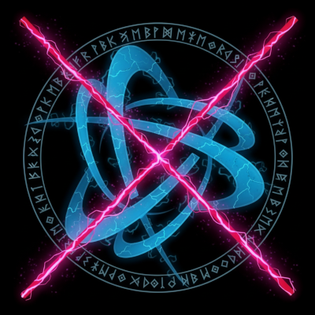
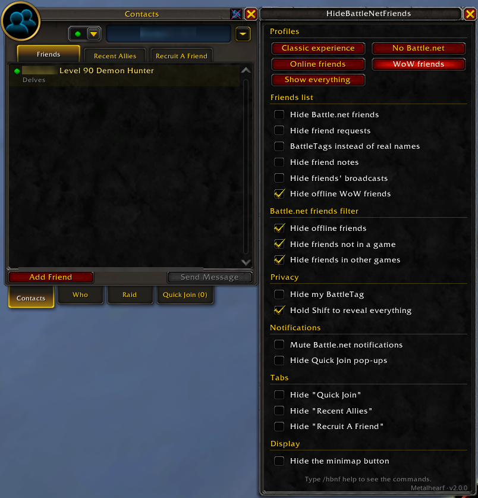
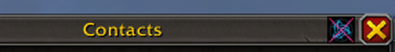
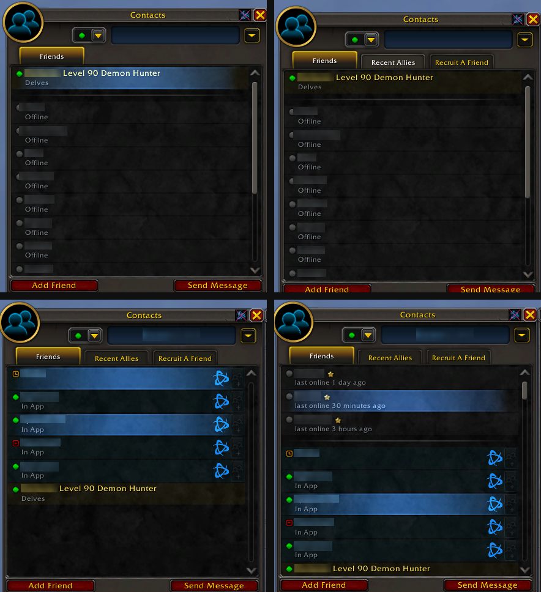

# HideBattleNetFriends

Keep your real names and Battle.net contacts out of World of Warcraft. Hide Battle.net friends entirely, show BattleTags instead of real names, or filter the list down to the friends who are actually playing WoW. Every change shows up live in your friends list.

## Why?

- **Streaming and screenshots** - real names never show up on stream: not in the friends list, tooltips, whispers, pop-ups or chat.
- **A cleaner friends list** - see only the people playing WoW right now, not everyone idling in the Battle.net app or playing another game.
- **The classic feel** - one click turns the friends list back into the plain WoW friends list, without Battle.net clutter or modern tabs.

## Profiles

Pick a starting point, then fine-tune any option by hand.

| Profile | What you get |
|---|---|
| **Classic experience** | No Battle.net at all: friends, requests, notifications, your BattleTag and the modern tabs are hidden. |
| **No Battle.net** | Same, but keeps the tabs. Not on Forever, where it would be identical to Classic experience. |
| **Online friends** | Every friend, but only those who are online. |
| **WoW friends** | Only friends playing World of Warcraft right now. |
| **Show everything** | Nothing hidden, the friends list as Blizzard made it. |

## Options

**Friends list**
- Hide Battle.net friends
- Hide friend requests
- BattleTags instead of real names, everywhere a real name can appear (see below)
- Hide friend notes and friends' broadcasts
- Hide offline WoW (character) friends

**Battle.net friends filter**
- Hide offline friends
- Hide friends who are only in the Battle.net app or mobile app
- Hide friends playing another game

**Privacy**
- Hide your own BattleTag at the top of the friends list
- Hold **Shift** while opening the friends list to see everything until you close it

**Notifications**
- Mute Battle.net notifications (online, offline, broadcasts, requests). Your previous settings come back when you turn it off.
- Hide Quick Join pop-ups

**Display**
- Hide the minimap button
- Hide the friends list button, for a minimal friends list

**Tabs** (Retail)
- Hide the Quick Join, Recent Allies and Recruit A Friend tabs

Options that do not exist on your version of the game are not shown.

### WoW Forever

Forever has a new social window, and Blizzard blocks any addon that changes its friends list. HideBattleNetFriends keeps Blizzard's window (tabs, status, search, Filter button) and lays its own filtered copy of the friends list over it.

- **Hide Battle.net friends** keeps your in-game friends (their character names) and hides Battle.net/BattleTag friends.
- **Hide offline WoW friends** applies to those in-game friends.
- Blizzard's search and Filter button still work on the filtered list.
- Hiding friend requests and tabs is not available there: it would mean changing Blizzard's window.

### Where real names are replaced

With *BattleTags instead of real names*, the BattleTag (without its #number) replaces the real name in:

- the friends list and its tooltip
- Battle.net whispers, sent and received, and the "Tell ..." line while typing (`/r` still works)
- separate whisper tabs
- online/offline messages in chat (clicking the name still opens a whisper)
- Battle.net pop-up notifications
- the right-click menu on a Battle.net friend
- the block, remove and note confirmation dialogs

## Commands

| Command | What it does |
|---|---|
| `/hbnf` | Open or close the settings window |
| `/hbnf off` | Turn all hiding off until the next `/reload` |
| `/hbnf on` | Turn it back on |
| `/hbnf buttons` | Show the minimap and friends list buttons again |
| `/hbnf help` | List these commands in chat |

### Where to find the settings

- **Friends list:** the HideBattleNetFriends button at the top right of the friends list, next to the close button.
- **Minimap:** the round HideBattleNetFriends button (drag it to move it).
- **Addon compartment:** the addons button under the minimap (Retail).
- **Game options:** *Options > AddOns > HideBattleNetFriends*.
- **Chat:** `/hbnf`.

A key binding for on/off is in *Options > Key Bindings > AddOns*.

Hiding the minimap or friends list button is safe: `/hbnf` always opens the window, and `/hbnf buttons` brings both buttons back.

## Compatibility

| Client | Supported |
|---|---|
| Retail | Yes |
| Classic (Mists of Pandaria) | Yes |
| Classic Era | Yes |
| Anniversary Edition | Yes |
| Forever | Yes |

Available in English, French, German, Spanish, Italian, Portuguese, Russian, Korean and Chinese (simplified and traditional).

Nothing is changed on Blizzard's side: the addon only changes what your game displays. Your Battle.net friends are still there in the Battle.net app, and whispers and friend requests keep working.

## Installation

### From CurseForge
Install via [CurseForge](https://www.curseforge.com/wow/addons/hidebattlenetfriends) or any CurseForge-compatible addon manager (CurseForge app, WowUp, etc.).

### From GitHub Releases
1. Download `HideBattleNetFriends.zip` from the [latest release](https://github.com/Metalhearf/HideBattleNetFriends/releases/latest).
2. Extract the `HideBattleNetFriends` folder into your WoW addons directory:
   - **Windows:** `C:\Program Files (x86)\World of Warcraft\_retail_\Interface\AddOns\`
   - **macOS:** `/Applications/World of Warcraft/_retail_/Interface/AddOns/`
3. Restart WoW or type `/reload` in-game.

### Manual
Clone this repository and copy (or symlink) the `HideBattleNetFriends/` folder into your AddOns directory.

## Screenshots

*The same friends list under Classic experience, No Battle.net, Online friends and Show everything.*

## Contributing

Contributions are welcome! Feel free to open issues or submit pull requests.

## License

This project is licensed under the [GNU General Public License v3.0](LICENSE).

Made by Metalhearf.
